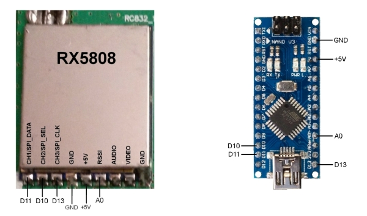
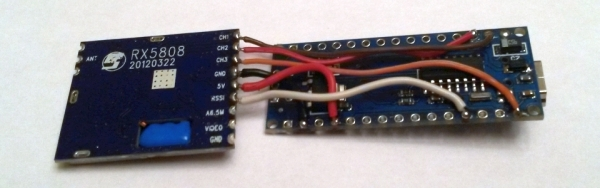
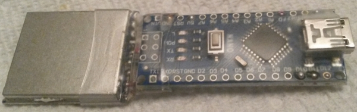

# USB Nodes

Hardware nodes may be connected into the system via USB. A node can be created with an Arduino, an RX5808 module, and six wires; with the connections shown below.





The above build uses an Arduino Nano V3.0 16M 5V ATmega328P module (which can be found on [eBay](https://www.ebay.com/sch/i.html?_nkw=Arduino+Nano+V3.0+16M+5V+ATmega328P)) and an RX5808 module (which can be found on [banggood](https://www.banggood.com/search/rx5808-module.html) and [eBay](https://www.ebay.com/sch/i.html?_nkw=rx5808+module)).

USB nodes may be plugged into the USB ports of the Raspberry Pi on a standard RotorHazard timer build, and they will appear in the system as serial ports.  If the timer also has "standard" (PCB-based) nodes, the USB/serial nodes will add to the total number of nodes available. (Node counts of 9 or higher are possible.)

The nodes may also be attached (via USB) to [any computer running the RotorHazard server](Software%20Setup.md#otheros).  

USB nodes need to be configured in the server. On the _Advanced Settings_ page in the _Hardware_ panel, you can add ports in the _Serial Ports_ section. Simply type an item into the `New Port` input and complete the entry (click outside or use the tab key to defocus). A new `Port` entry will be added. Add multiple items if desired, or clear the input to remove.

The `List Ports` button below the port entries shows all serial ports the server process can see, including alias names (such as the stable `/dev/serial/by-id/...` names on Linux), a device description, and whether the server has read/write access to the port. Use the `Add` button next to a port to add it to the configuration; it uses the most stable name available. On Linux, a `/dev/serial/by-id/...` name is used for adapters that have a USB serial number, and it follows the adapter to any USB port. Adapters without a serial number (such as many CH340-based Arduino Nano clones) can share the same `by-id` name, so for them a `/dev/serial/by-path/...` name is used, which stays the same only while the adapter is plugged into the same USB port. On a Raspberry Pi, the on-board UART is added as `/dev/serial0`. If a port shows "No access" on Linux, the server user typically needs to be added to the group shown (usually `dialout`).

#### Raspberry Pi

On the Raspberry Pi, an attached USB node will be referenced with a serial port name like "/dev/ttyUSB0". The command ```ls /dev/ttyUSB*``` will show the current USB serial ports.

#### Windows Computer

On a Windows computer, an attached USB node will be referenced with a serial port name like "COM5". The current ports may be viewed in the Windows Device Manager under "Ports (COM & LPT)" -- when the USB node is plugged in, its entry should appear. It may be necessary to install or update its driver (named something like "USB-SERIAL").

#### Node Code

The RotorHazard node code will need to be uploaded (flashed) to the Arduino using [the "standard" method](https://github.com/RotorHazard/RotorHazard/blob/main/src/node/readme_Arduino.md) (via the Arduino IDE). The NODE_NUMBER value (in "src/node/config.h") is ignored for USB nodes; it can be left at 0.

#### Network Nodes

A node may also be connected over the network, through a bridge that passes the node's serial data to and from a TCP port (for example ser2net, an ESP32-based Ethernet-to-serial bridge, or a script on another computer). Enter its address as a port, in the form `socket://host:port`; for instance `socket://192.168.1.51:2217` or `socket://gate1.local:2217`. The server then talks to the node exactly as it does to a USB node.

* The server connects with Nagle's algorithm off (TCP_NODELAY). The bridge should also forward each byte as soon as it arrives, and set TCP_NODELAY on its side: the node protocol sends many small requests, and buffering them adds tens of milliseconds to each one.
* Use a wired network. Each node is polled with many short request/reply exchanges, so Wi-Fi delays slow down every update.
* A network node that stops answering for about 2 seconds (cable pulled, bridge powered off) is treated like an unplugged USB node: the server retries the connection and restores the node's settings when it answers again. A configured network node that is not reachable when the server starts is opened once it becomes reachable.
* The `List Ports` button shows configured network nodes, and whether they can be reached.

<br/>

-----------------------------

See Also:  
[doc/Hardware Setup.md](Hardware%20Setup.md)  
[doc/Software Setup.md](Software%20Setup.md)  
[doc/User Guide.md](User%20Guide.md)
